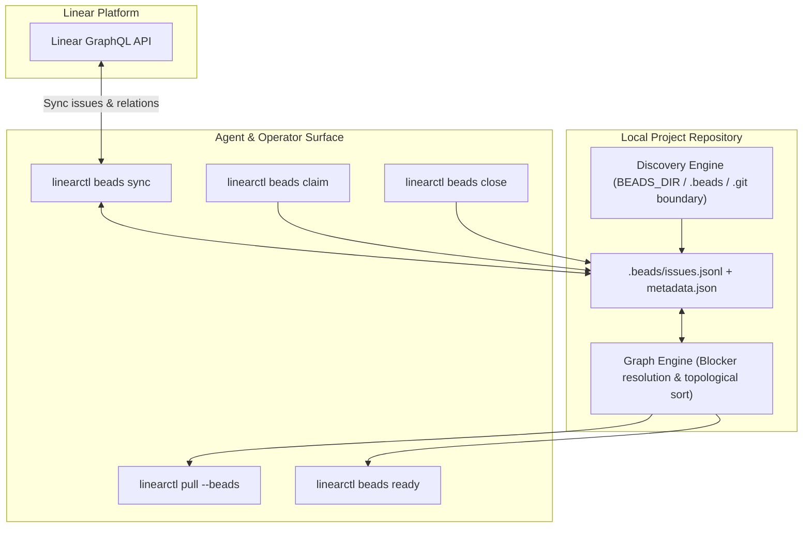

# Feature: `linearctl beads` — Optional, Discovery-Based Beads Graph Integration

**Status:** implemented
**Command:** `linearctl beads [init|status|sync|pull|push|ready|show|claim|close|export|import]` · `linearctl pull --beads`
**Integration:** [gastownhall/beads](https://github.com/gastownhall/beads) (`bd`)

## Motivation

Autonomous coding agents (such as Claude Code, AGY, and custom harnesses) often struggle with long-horizon tasks and flat markdown task lists. When tasks are organized in a flat structure, agents cannot reliably determine which tasks are unblocked and ready to execute.

[Beads](https://github.com/gastownhall/beads) solves this by providing a persistent, dependency-aware directed graph issue tracker with:
- Blocker/dependency tracking (`blocks`, `duplicates`, `related`, `parent-child`).
- Unblocked work discovery (`bd ready`).
- Atomic task claims (`bd update --claim`).
- Dynamic unblocking on close (`bd close`).

`linearctl beads` provides an optional, discovery-based integration. It brings Beads graph-based task management directly to Linear issues locally, without requiring remote network roundtrips during agent execution.

---

## Design Principles: Optional & Discovery-Based

1. **Non-Invasive & Optional**:
   - Projects without Beads continue to work identically without any performance impact or side effects.
   - `linearctl` never creates `.beads/` directories unless explicitly initialized with `linearctl beads init`.
   - All standard commands (`pull`, `search`, `file`, `update`, etc.) operate normally without Beads.

2. **Automatic Discovery**:
   - `linearctl` discovers Beads workspaces by checking:
     1. `BEADS_DIR` environment variable.
     2. Upward directory walk for `.beads/` up to repository boundary (`.git`).
     3. Direct `issues.jsonl` files (git-free / stealth mode).
     4. Detection of system `bd` CLI in `$PATH`.
   - If a Beads workspace is discovered, local graph operations and `pull --beads` activate seamlessly.
   - If no Beads workspace exists and a beads-specific command is called, `linearctl` exits cleanly with a helpful error:
     ```
     error: No Beads workspace discovered. Run 'linearctl beads init' to initialize, or set BEADS_DIR.
     ```

3. **Dual Execution Engine**:
   - **System `bd` CLI Interop**: If `bd` is installed on the host, `.beads` metadata and `issues.jsonl` are 100% compatible. Agents can use both `linearctl beads` and `bd` interchangeably.
   - **Embedded TypeScript Engine**: If `bd` is not installed (e.g. in CI or lightweight environments), `linearctl` includes a complete standalone graph engine with zero external dependencies.

---

## Architecture & Data Flow



---

## Field & Graph Mapping

### State Mapping

| Linear State Type | Beads Status | Description |
|---|---|---|
| `backlog`, `unstarted` | `open` | Unstarted task |
| `started` | `in_progress` | Active / claimed task |
| `completed`, `canceled` | `closed` | Done or discarded task (unblocks dependents) |

### Priority Mapping

| Linear Priority | Beads Priority | Label |
|---|---|---|
| 1 (Urgent) | 0 | Critical / P0 |
| 2 (High) | 1 | High / P1 |
| 3 (Medium) | 2 | Medium / P2 |
| 4 (Low) | 3 | Low / P3 |
| 0 (None) | 4 | Backlog / P4 |

### Relation Mapping

- **Linear Blocks**: Relation `issue = A` blocks `relatedIssue = B` maps to Beads dependency where `issue_id = B`, `depends_on_id = A`, `type = "blocks"`.
- **Linear Duplicate**: `type = "duplicates"`.
- **Linear Related**: `type = "related"`.
- **Linear Parent/Child**: Sub-issue maps to `type = "parent-child"` dependency pointing to the parent issue.

---

## CLI Reference

### 1. `linearctl beads init`

Initialize a Beads workspace in the current repository:

```bash
linearctl beads init --team CER
```

Options:
- `--team <key>`: Target Linear team key.
- `--project <ref>`: Target Linear project id.
- `--id-mode <linear|hash>`: ID format (default `linear`).
- `--json`: Emit JSON.

### 2. `linearctl beads status`

Show workspace location, backend, `bd` CLI availability, counts, and readiness:

```bash
linearctl beads status
```

### 3. `linearctl beads sync`

Synchronize between Linear and local Beads graph state:

```bash
# Bidirectional sync (pull from Linear, then push local changes)
linearctl beads sync

# Pull only
linearctl beads sync --pull

# Push only
linearctl beads sync --push

# Dry run preview
linearctl beads sync --dry-run
```

### 4. `linearctl beads ready`

List unblocked Linear issues ready to claim:

```bash
# Table view
linearctl beads ready

# Filtered by priority
linearctl beads ready --priority 0

# Machine-readable JSON for agents
linearctl beads ready --json
```

### 5. `linearctl beads claim <id>`

Atomically claim an issue:

```bash
linearctl beads claim CER-101 [--push]
```

### 6. `linearctl beads close <id>`

Close an issue and report newly unblocked tasks:

```bash
linearctl beads close CER-101 --reason "Fixed in commit abc1234" [--push]
```

Output:
```
✓ Closed CER-101
  2 downstream task(s) unblocked and now ready:
    - CER-102: Implement authentication UI
    - CER-105: Integration test suite
```

### 7. Ingestion Funnel Integration: `linearctl pull --beads`

Agents running background reconcile loops can pass `--beads` to stream only unblocked ready tasks:

```bash
linearctl pull --beads --json
```
