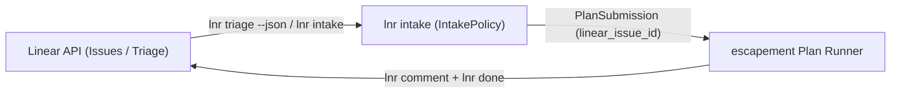

# `lnr` (`linearctl`) Setup, Operations & Intake Runbook

This runbook is the canonical guide for installing, authenticating, configuring, and operating `lnr` (backward-compatible alias: `linearctl`), including how autonomous agent lanes translate Linear triage items into escapement `PlanSubmission` payloads.

---

## 1. Installation & Build

### Prebuilt Release Binary

Download the latest release binary for your platform from GitHub Releases (`cerebral-work/lnr`) and install both `lnr` and the `linearctl` alias on your `PATH`:

```bash
install -m 0755 lnr ~/.local/bin/lnr
ln -sf ~/.local/bin/lnr ~/.local/bin/linearctl
lnr --version
```

### Building from Source

Prerequisites:
- [Bun](https://bun.sh) `>= 1.2`
- Rust toolchain pinned in `rust-toolchain.toml` (`1.91.1`)

Build both the TypeScript/Bun binaries (`dist/lnr`, `dist/linearctl`) and the Rust workspace (`target/debug/lnr`):

```bash
# Always cap cargo parallelism at -j 2 on shared hosts
make build JOBS=2

# Or install the Rust CLI and xtask contracts via xtask
cargo run -p xtask -j 2 -- install
```

---

## 2. Authentication

`lnr` reads credentials strictly from the `LINEAR_API_KEY` environment variable. It never stores credentials on disk or echoes secret values.

1. Create a Personal API Key in Linear (**Settings → Security & access → Personal API keys**).
2. Export `LINEAR_API_KEY` in your shell or inject it from your secret store (such as 1Password or OpenBao) into a `0600` environment file before invoking `lnr`:

```bash
# Verify presence without echoing the secret value
[ -n "${LINEAR_API_KEY:-}" ] && echo "LINEAR_API_KEY is set"

# Verify live API connectivity and identity
lnr whoami --json
lnr doctor --json
```

---

## 3. Configuration & Precedence

`lnr` works with zero configuration files when `--team <KEY>` is passed on the command line. For repository or workstation defaults, `lnr` searches the following paths in order (`.lnr` takes precedence over `.linearctl`):

1. **Environment variables:**
   - `LINEAR_API_KEY` — Linear API key (required for live API calls)
   - `LNR_TEAM` / `LINEAR_DEFAULT_TEAM` — default team key (e.g., `ENG`)
   - `LNR_PROJECT` / `LINEAR_DEFAULT_PROJECT` — default project name
2. **Project-local config:** `.lnr/config.json` (fallback: `.linearctl/config.json`)
3. **User-global config:** `~/.config/lnr/config.json` (fallback: `~/.config/linearctl/config.json`)

Initialize or inspect configuration with:

```bash
# Interactive or flag-driven config initialization
lnr config init --team ENG

# Inspect resolved config and active workspace state
lnr config show --json
lnr context --json
```

---

## 4. Agent Contract & Machine Introspection

Autonomous agents must use `lnr`'s machine-readable introspection flags before constructing commands:

```bash
# Full command catalog, global flags, and exit codes
lnr --agent-help

# JSON Schema for any command's input arguments and output payload
lnr --schema issue.list
lnr --schema intake

# Executable bash examples for any command
lnr --examples triage
lnr --examples intake

# Validate arguments without mutating remote Linear state
lnr create --team ENG --title "Fix race in worker pool" --dry-run --json
```

### Exit Code Contract

| Exit Code | Meaning |
|---|---|
| `0` | Success |
| `1` | Runtime or GraphQL API error |
| `2` | Usage or validation error (invalid flags, bad identifier, failed precondition) |
| `3` | Resource not found |
| `4` | Authentication failure (`LINEAR_API_KEY` missing or invalid) |
| `5` | Rate-limited by Linear API |

---

## 5. Core Operations: Triage, Grooming & Issue Lifecycle

### Triage & Backlog Grooming

```bash
# List untriaged / unstarted issues with priority, estimate, labels, and project
lnr triage --team ENG --json

# Run backlog hygiene audit (stale WIP, missing estimates, orphan issues)
lnr groom --team ENG --json

# Check local cache, config, and API health
lnr doctor --json
```

### Issue Lifecycle (Claim → Branch → Ship → Close)

Every tracker mutation should be executed one write at a time and re-read to verify effect:

```bash
# 1. Start work on an issue
lnr start ENG-123 --json

# 2. Record shipping evidence first (commit SHA or PR URL)
lnr comment ENG-123 "Shipped in commit abc1234 (PR #42)." --json

# 3. Transition issue to Done
lnr done ENG-123 --json

# 4. Re-read to confirm terminal state
lnr show ENG-123 --json --fields identifier,state
```

---

## 6. `lnr → escapement` Intake Edge Specification

The `lnr intake` command (backed by `crates/lnr-domain::intake` in Rust and `src/core/intake.ts` in TypeScript) implements the pure translation edge from Linear issues / `lnr triage` items into escapement `PlanSubmission` records.



### 6.1 Enriched `TriageItem` Input Surface

`lnr triage --json` emits `TriageItem` records containing all fields required for intake filtering without N+1 queries:

| Field | Type | Description |
|---|---|---|
| `identifier` | `string` | Canonical Linear issue key (e.g., `"ENG-123"`). |
| `title` | `string` | Issue title. |
| `priority` | `number` | Linear priority (`0`=None, `1`=Urgent, `2`=High, `3`=Medium, `4`=Low). |
| `estimate` | `number \| null` | Point estimate (or `null` if unestimated). |
| `state` | `string` | Workflow state name (e.g., `"Triage"`, `"Todo"`). |
| `stateType` | `string` | Linear state category (`triage`, `backlog`, `unstarted`, `started`, `completed`, `canceled`). |
| `labels` | `string[]` | Sorted issue label names. |
| `project` | `string \| null` | Project name if assigned. |
| `assignee` | `string \| null` | Assignee display name or email. |

### 6.2 Eligibility Rules (`IntakePolicy`)

An issue is eligible for autonomous intake when all of the following hold:
1. **State type:** `stateType` is in `allowedStateTypes` (default: `["triage", "backlog", "unstarted"]`). Already-completed or canceled issues are rejected.
2. **Blocked labels:** None of the issue's `labels` match `blockedLabels` (default: `["blocked", "do-not-automate", "needs-human", "wontfix"]`).
3. **Required labels:** When `--require-label <LABEL>` is configured (e.g., `agent-eligible`), the issue must carry every required label.

### 6.3 Field Mapping (`TriageItem` / `Issue` → `PlanSubmission`)

1. **Round-Trip Correlation (`linear_issue_id`):**
   - `submission.linear_issue_id` is always set to the canonical `identifier` (e.g., `"ENG-123"`).
   - Downstream runners pass `linear_issue_id` back to `lnr comment <linear_issue_id> ...` and `lnr done <linear_issue_id>` upon completion.
2. **Priority → Execution Tier (`tier`):**
   - `1` (Urgent) or `2` (High) → `"capable"`
   - `3` (Medium) → `"balanced"`
   - `4` (Low) → `"fast"`
   - `0` (Unprioritized) → `"review"`
3. **Labels → Workflow (`workflow`):**
   - `security`, `cve`, `vulnerability` → `"security-fix"`
   - `bug`, `incident`, `regression`, `defect` → `"bugfix"`
   - `docs`, `documentation`, `runbook` → `"docs"`
   - `chore`, `maintenance`, `refactor`, `deps` → `"chore"`
   - Fallback → `defaultWorkflow` (`"feature"`)
4. **Estimate → Token Budget (`budget.maxTokens`):**
   - When `estimate` is present and `> 0`: `round(estimate * tokensPerPoint)` (default `32000` tokens/point), clamped to `[16000, 512000]`.
   - When `estimate` is `null` or `0`: `defaultMaxTokens` (`64000`).

### 6.4 CLI Usage Examples

```bash
# Convert a single Linear issue into an escapement PlanSubmission JSON payload
lnr intake ENG-123 --json

# Convert eligible triage items for team ENG requiring label 'agent-eligible'
lnr intake --triage --team ENG --require-label agent-eligible --json

# Include filtered-out items with rejection reasons for audit visibility
lnr intake --triage --team ENG --require-label agent-eligible --all --json
```

---

## 7. MCP Server & Kubernetes Operator

### Stdio MCP Server

```bash
# Start the Model Context Protocol server over stdio
lnr mcp serve
```

### Kubernetes Operator

```bash
# Validate CRDs and operator configuration in dry-run mode
lnr operator --dry-run --json
```
